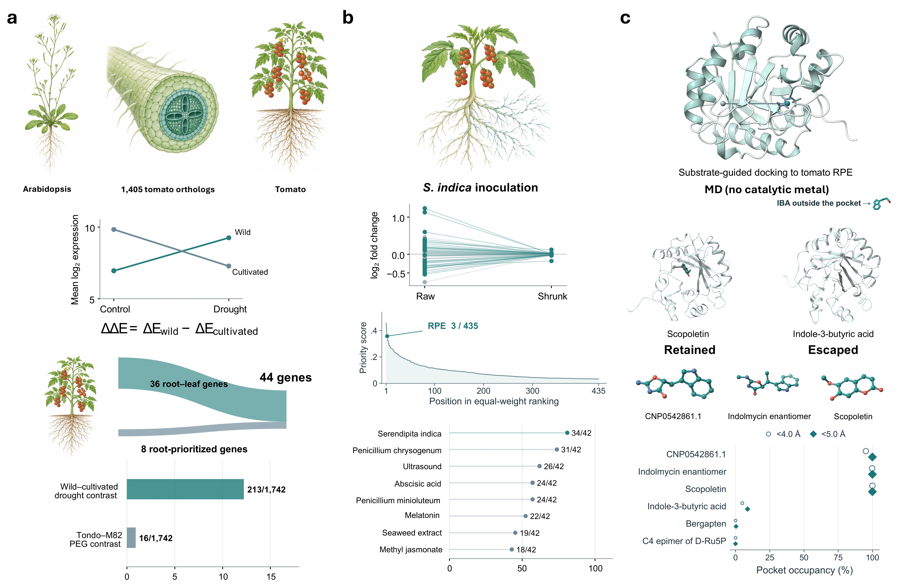

# TomatoRPE

TomatoRPE provides analysis code and reference tables for tomato drought responses and natural product screening against ribulose-5-phosphate 3-epimerase. The notebook reproduces selected study summaries and plots archived molecular dynamics measurements by system.

[](https://doi.org/10.5281/zenodo.24425383) [](https://colab.research.google.com/github/mybagi/TomatoRPE/blob/main/notebooks/TomatoRPE_quickstart.ipynb)



## Repository structure

```text
TomatoRPE/
├── README.md
├── assets/
├── notebooks/TomatoRPE_quickstart.ipynb
└── src/
```

## Run locally

Use Python 3.11 or later. Clone the repository and reproduce the summaries from the bundled reference tables.

```bash
git clone https://github.com/mybagi/TomatoRPE.git
cd TomatoRPE
python src/reproduce.py
```

The summary covers root interaction estimates, target rankings, docking scores, and molecular dynamics observations. See the [analysis workflow notes](src/workflows/README.md) for source inputs and the scope of the archived ranking.

## Verify a trajectory

Download the first zinc-bound replicate of native D-ribulose 5-phosphate from Zenodo. The download command uses PowerShell on Windows and curl on macOS and Linux. The verifier checks frame times and minimum substrate distances to the fixed protein pocket.

```bash
python src/download_trajectory.py --system native_D-Ru5P_with-Zn_rep1 --output /path/to/downloads
python -m pip install -r src/requirements/md.txt
python src/verify_md_trajectory.py --trajectory-dir /path/to/downloads --system native_D-Ru5P_with-Zn_rep1
```

The notebook also plots the archived time series and exports its data and figure. The default example uses only the bundled tables.

## Data

The [Zenodo archive](https://doi.org/10.5281/zenodo.24425383) provides 13 trajectories with a starting structure and a GROMACS run input for each system. The [trajectory index](assets/trajectory_systems.tsv) maps system identifiers to files. The [file checksums](assets/trajectory_files.tsv) record the published sizes and hashes. The [source accession table](assets/source_accessions.tsv) links the original public transcriptomic datasets.

[Supplementary Data 1](assets/manuscript_tables/Supplementary_Data_1_435_root_interactions.csv) contains the root interaction estimates, [Supplementary Data 2](assets/manuscript_tables/Supplementary_Data_2_Vina_score_mass_pairs.csv) contains the docking scores and molecular weights, and [Supplementary Data 3](assets/manuscript_tables/Supplementary_Data_3_435_root_priority_sensitivity.tsv) and [Supplementary Data 4](assets/manuscript_tables/Supplementary_Data_4_revised44_structure_eligibility.tsv) document target ranking and structural eligibility.

## Contact

For questions about the code, [open an issue](https://github.com/mybagi/TomatoRPE/issues) or contact [Mingyu Bian](https://github.com/mybagi) and [Yiquan Wang](https://github.com/wyqmath). [Code citation](assets/CITATION.cff)
